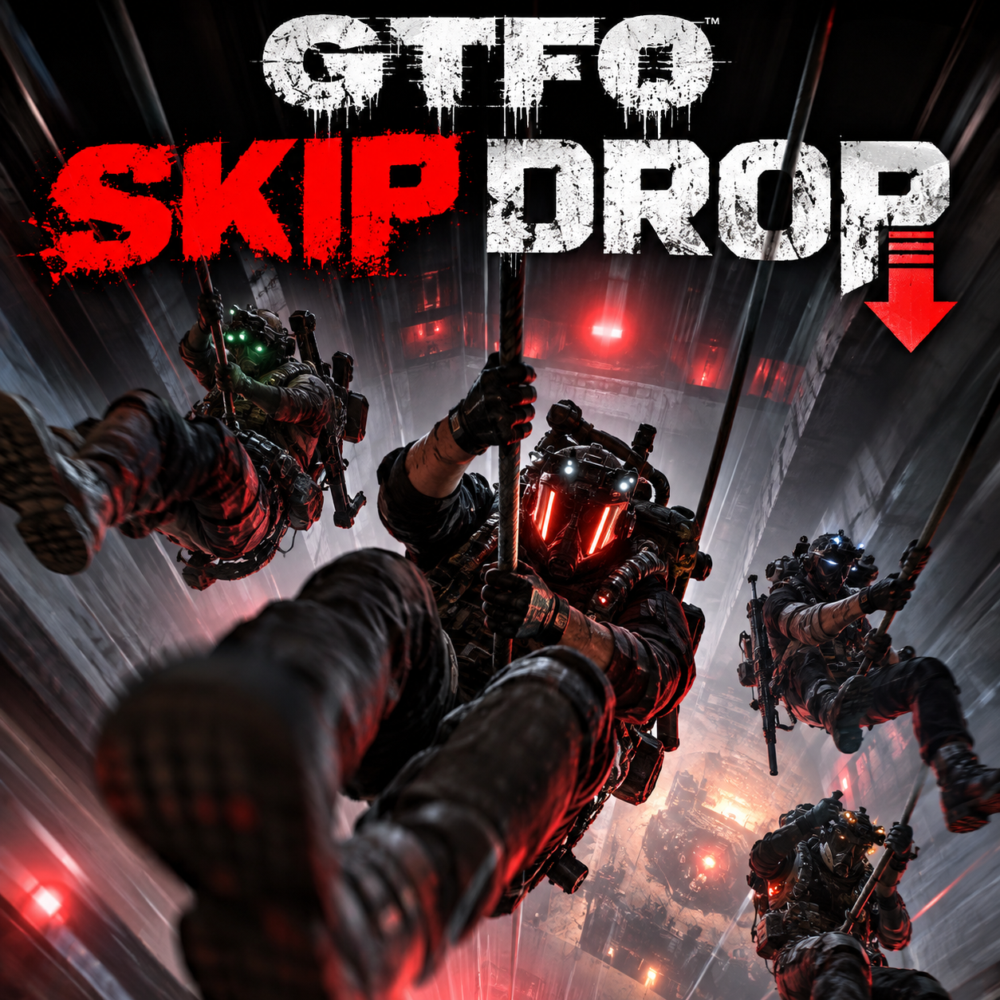

# GTFO.SkipDrop

A BepInEx IL2CPP plugin for GTFO that skips the opening elevator animation and shortens the fall at the start of every expedition, so you reach the level as fast as the game can build it.

-blue)

-success)



Try it: build the package with `build.ps1` (see Quick start). The Thunderstore package name is
`GtfoSkipDrop`, since Thunderstore names can't contain a period.

## Why

- Get into the level without sitting through the drop or holding the skip button every expedition.
- The fall itself gets shorter too, not just the opening animation: the game's forced minimum fall
  time and its fixed delays are removed for the drop.
- One job and nothing else: the config holds a single on/off switch.
- Safe across game updates: if the elevator code it hooks is renamed, the plugin logs an error and
  leaves the drop alone instead of crashing the game.

## Features

- **Skips the opening animation** by calling the game's own `ElevatorRide.SkipPreReleaseSequence()`,
  the same thing holding the in-game skip button does.
- **Shortens the fall**: no forced minimum fall time, no wait before the cage releases, no engine
  start delay, and the landing brake cut to 0.1s, with the game's built-in fast-elevator dev mode
  on for the duration of the drop.
- **Puts the game back the way it was**: the fast-elevator flag is game-wide, so it's restored when
  the ride stops, or when the elevator is cleaned up after a drop that was cut short.
- **Drop timings in the log**: each drop writes `Drop took N.Ns.` and a per-phase breakdown to
  `BepInEx/LogOutput.log`.
- **Master switch**: `[0. Mod] Enabled` turns the whole mod off without uninstalling it.

The cage can't land before the level finishes generating, so level generation time is the floor.
On a slow machine or a big level the drop won't get down to a couple of seconds.

## Quick start

Prerequisites: GTFO, BepInExPack_GTFO installed in a Thunderstore Mod Manager (or r2modman)
profile, and the .NET 6 SDK or later.

```powershell
git clone https://github.com/mindattic/GTFO.SkipDrop.git
cd GTFO.SkipDrop
.\build.ps1 -Profile "Easy Mode DEV"
```

`-Profile` is the mod manager profile name without the `GTFO - ` prefix; `Easy Mode DEV` is the
default. The build lands straight in that profile's `BepInEx/plugins/GTFO.SkipDrop/` folder and
also writes `dist/GTFO.SkipDrop-<version>.zip` for sharing or upload.

Launch the game from that profile and start a rundown. You should see the drop skipped, and
`BepInEx/LogOutput.log` should show `GTFO.SkipDrop v4.0.0 loaded.` followed by `Drop took N.Ns.`
once the cage lands.

## Configuration

`BepInEx/config/MindAttic.GTFO.SkipDrop.cfg`, created on first launch:

| Setting | Default | What it does |
|---|---|---|
| `[0. Mod] Enabled` | `true` | Turn the whole mod on or off. When false, the mod loads nothing: no patches, and the drop plays at the game's normal speed. It's the file's first entry, so the mod can be switched off where a mod manager profile doesn't list it. Takes effect on restart. |

There are no hotkeys or commands; the mod works on its own every expedition.

## How it works

```text
StartPreReleaseSequence --postfix--> SkipPreReleaseSequence()      opening animation skipped
StartElevatorRide       --prefix---> MinTimeLooping = 0             fall shortened
                                     Global.FastElevator = true
                                     m_startDelay = 0, m_engineStartDelay = 0, m_endDur = 0.1
ChangeState             --prefix---> log the previous phase's duration
StopElevatorRide        --postfix--> restore FastElevator, log "Drop took N.Ns."
Cleanup                 --postfix--> restore FastElevator if the drop was cut short
```

Two parts:

1. **Opening animation**: a postfix on `ElevatorRide.StartPreReleaseSequence` calls the game's own
   `ElevatorRide.SkipPreReleaseSequence()`.
2. **The fall**: a prefix on `ElevatorRide.StartElevatorRide` sets `ElevatorRide.MinTimeLooping`
   (the game's forced minimum fall time) to 0 and turns on the game's built-in dev flag
   `Globals.Global.FastElevator`. It also zeroes the ride's fixed delays (`m_startDelay`,
   `m_engineStartDelay`) and cuts the landing brake (`m_endDur`) to 0.1s; that one stays above 0
   because the landing lerps over it. A postfix on `StopElevatorRide` restores the fast-elevator
   flag, since it's game-wide, and logs `Drop took N.Ns.`; a prefix on `ChangeState` logs each
   phase's duration (`Middle` is the cage looping while the level generates). A drop cut short
   (leaving mid-drop) never reaches `StopElevatorRide`, so a postfix on `ElevatorRide.Cleanup`
   restores the flag instead, once `ElevatorRide.ElevatorRideInProgress` reads false.

Everything is looked up by name at runtime (`AccessTools`), so the project builds against
BepInEx's core DLLs alone and doesn't need the game's generated interop assemblies. If a game
update renames any of it, the plugin logs `Elevator members not found - game update?` and patches
nothing. Every hook catches its own errors, so a failure leaves that drop vanilla rather than
breaking the game's elevator.

## Project layout

```text
src/GTFO.SkipDrop/    the plugin project (one file: Plugin.cs)
tests/                GTFO.SkipDrop.Tests - NUnit, runs with plain dotnet test, no game needed
package/              exactly what ships to Thunderstore / gets zipped for sharing
  manifest.json       Thunderstore package name is "GtfoSkipDrop" (no period allowed there)
  README.md           becomes the Thunderstore page
  CHANGELOG.md
  LICENSE             TheArchive's MIT notice (required attribution)
  icon.png            256x256 package icon, resized from logo.png
build.ps1             builds the plugin and packages dist/GTFO.SkipDrop-<version>.zip
logo.png              full-size logo
```

## Building

```powershell
.\build.ps1                      # uses the Thunderstore Mod Manager profile "Easy Mode DEV"
.\build.ps1 -Profile MyProfile
```

`build.ps1` also takes `-Configuration` (default `Release`) and `-GameName` (default `GTFO`). It
reads the version from `package/manifest.json`, copies the built DLL into `package/`, and zips the
folder into `dist/`.

If you're on the older r2modman app, its profiles live under a different path. Pass it directly:

```powershell
dotnet build .\src\GTFO.SkipDrop\GTFO.SkipDrop.csproj -p:BepInEx="$env:AppData\r2modmanPlus-local\GTFO\profiles\Default\BepInEx"
```

## Testing

```powershell
dotnet test tests/GTFO.SkipDrop.Tests/GTFO.SkipDrop.Tests.csproj
```

NUnit, no game needed. The tests point the plugin's reflected members at fake `ElevatorRide` and
`Global` types and drive the hook methods directly: timings get cut, `FastElevator` is restored
(including after an aborted drop, by the elevator's cleanup, but not during a live ride), and no
hook ever throws into the game's own method. They still need the BepInEx profile from Building,
since they reference its core DLLs.

The Harmony patching itself only runs against the real game, so after a build also launch a
rundown in the profile and confirm the drop is skipped and `LogOutput.log` shows
`GTFO.SkipDrop vN.0.0 loaded.`

## Versioning

v1, v2, v3 and so on: major-only bumps, matching the convention across other MindAttic projects.
Thunderstore requires `manifest.json`'s `version_number` to be strict `x.y.z`, so v4 is `4.0.0`.
`package/CHANGELOG.md` headers use the short `vN` form. The current version is v4.

## Publishing to Thunderstore

Run `build.ps1` and upload `dist/GTFO.SkipDrop-<version>.zip`. `package/icon.png` (256x256,
resized from `logo.png`) is the package icon; Thunderstore rejects packages without one. The
package depends on `BepInEx-BepInExPack_GTFO-3.2.3`.

## Limitations

- Level generation time is the floor: the cage can't land before the level is built.
- Multiplayer is untested. The host decides when the ride stops, so in a lobby where others don't
  have the mod, expect the drop to be gated by the slowest player.
- Turning the mod on or off takes effect only after a restart.

## Documentation

- [package/README.md](package/README.md): the Thunderstore page.
- [package/CHANGELOG.md](package/CHANGELOG.md): what changed in each version.
- [User stories](docs/USER_STORIES.md): the generated ticket log.
- [AGENTS.md](AGENTS.md): instructions for coding agents working in this repo.

## License

This repo has no license file of its own; all rights reserved. The skip logic is based on the
**Skip Elevator Animation** feature of [TheArchive](https://github.com/AuriRex/GTFO_TheArchive) by
AuriRex, used under the MIT License; that copyright and license notice ships in
[package/LICENSE](package/LICENSE). If you want that feature along with a lot of other
quality-of-life options, install TheArchive instead of this mod.

Part of [MindAttic](https://mindattic.com) — see more projects at
[github.com/mindattic](https://github.com/mindattic). Related: [GTFO.EZ](https://github.com/mindattic/GTFO.EZ).
